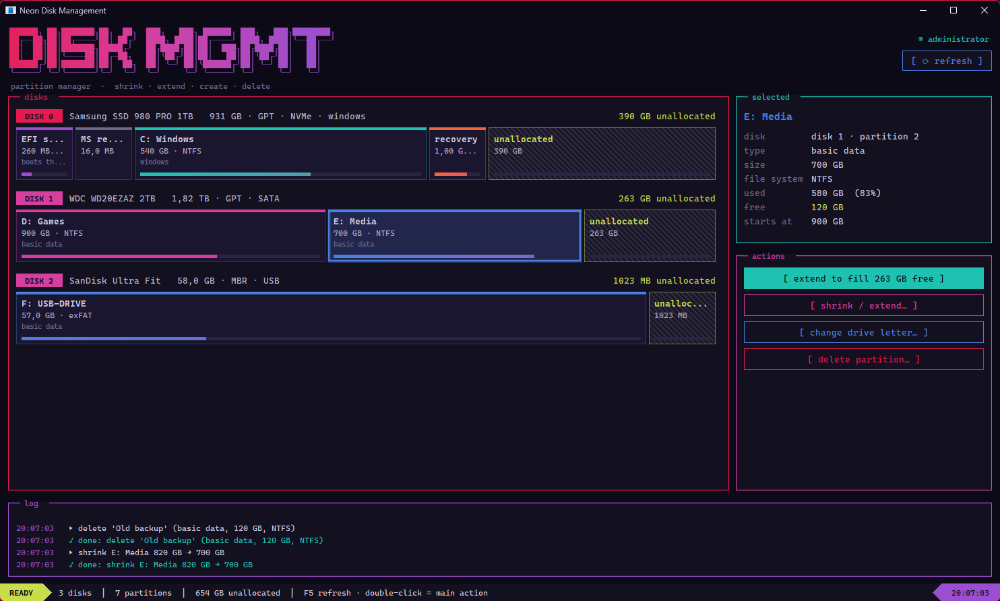
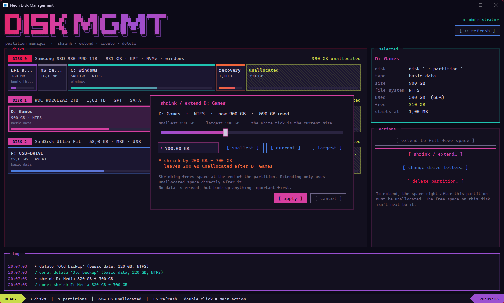
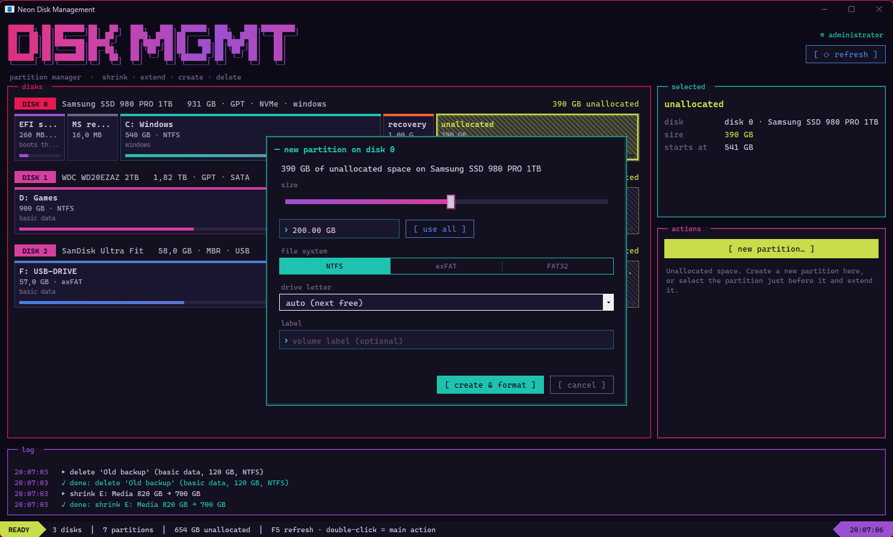

# Neon Disk Management

A simple neon partition manager for Windows, in the same style as Undelete.

- **Extend to fill free space**: one click grows a partition into the unallocated space right after it.
- **Shrink / extend…**: drag a slider or type a size (`300 GB`, `51200 MB`, `12,5 GB`). Windows supplies the smallest and largest allowed sizes.
- **New partition…**: create and format NTFS, exFAT or FAT32 in unallocated space, with a drive letter and label.
- **Change drive letter…**
- **Delete partition…**: you have to type `delete X` to confirm. Windows' own partition and the active EFI/system partition can't be deleted.
- **Initialize disk (GPT)**: for blank disks.



| | |
|---|---|
|  |  |

*Screenshots use sample disks.*

Operations go through the Windows Storage Management API (the same one Disk Management and `Resize-Partition` use), so Windows enforces its usual rules:
- Only NTFS and ReFS can be shrunk or extended.
- A partition can only extend into unallocated space directly after it.

## Use

Run `Disks.exe`. Anyone can view disks. To make changes, click **restart as administrator**.
Shortcuts: `F5` refreshes, the arrow keys move the selection, `Enter` or double-click runs the main action, and `Del` deletes.

## Build

```
powershell -ExecutionPolicy Bypass -File build.ps1
```
This needs no SDK, because it uses the .NET Framework `csc.exe` that ships with Windows.

`Disks.exe --list` writes a read-only `disks-list.txt` showing what the app sees.

## Packaging (MSIX / Microsoft Store)

`packaging\package.ps1` builds the MSIX. It needs `makeappx.exe`, `makepri.exe` and `signtool.exe` from the
[Windows SDK](https://developer.microsoft.com/windows/downloads/windows-sdk/) (or the `Microsoft.Windows.SDK.BuildTools` NuGet package),
placed at `tools\sdk-buildtools\pkg\bin\<version>\x64\`. They aren't included in this repository.

```
.\packaging\package.ps1 -Sign              # local test build, self-signed
.\packaging\package-store.ps1 -Version 1.0.0.0   # Store build (unsigned; Microsoft signs it)
```

`tools\make-assets.ps1` regenerates the icon and tile images. `packaging\STORE-LISTING.md` has the Partner Center submission text.

## Safety

This tool deletes and resizes partitions. Back up anything important first, and test on a small virtual disk if you're unsure.
It is provided as is, with no warranty.
